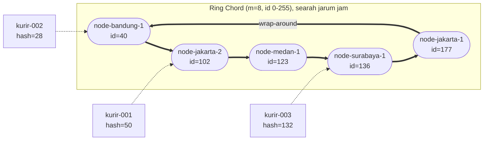
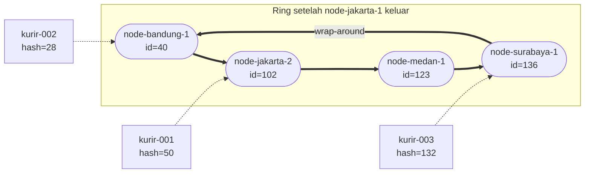

# Tugas 6 (Pekan 6) — Penamaan & Resolusi Lokasi

**Materi terkait:** Flat Naming, Structured Naming (DNS), Distributed Hash Table (DHT)/Chord.

## Studi Kasus

Pelanggan FoodGo kesulitan menemukan alamat IP server kurir yang **dinamis** (kurir berpindah lokasi/jaringan, IP-nya sering berubah). FoodGo butuh cara memetakan **ID Kurir** (identitas tetap) ke **alamat IP terkininya** tanpa server pusat tunggal yang jadi bottleneck/single point of failure.

## Tugas Kelompok

Implementasikan **simulasi Chord DHT** sederhana (single-process, tidak perlu jaringan sungguhan — cukup simulasi struktur data & algoritma di satu program Python) yang memetakan ID Kurir ke alamat IP mereka.

Konsep yang harus terlihat jalan dalam simulasi kalian:
1. **Consistent hashing**: ID Kurir dan ID Node di-hash ke ruang angka yang sama (mis. 0–255 untuk kesederhanaan, `m=8` bit).
2. **Ring topology**: node-node diurutkan melingkar berdasarkan hasil hash-nya.
3. **Lookup**: fungsi `lookup(kurir_id)` yang menemukan node mana yang bertanggung jawab menyimpan mapping ID Kurir tersebut → alamat IP-nya (aturan Chord: node dengan ID hash **terkecil yang lebih besar atau sama dengan** hash key, disebut *successor*).
4. **Perubahan topologi**: simulasikan minimal satu node baru bergabung (`join`) atau satu node keluar (`leave`), tunjukkan bagaimana mapping berpindah tanggung jawab ke node lain.

Skeleton disediakan di `src/chord_simulation.py` dengan fungsi hashing dan struktur ring sudah ada — bagian `lookup()`, `join()`, dan `leave()` sengaja dikosongkan.

### Cara Menjalankan

```bash
python3 src/chord_simulation.py
```

## Tugas Analisis (`README.md`)

1. Jelaskan **kenapa DHT/Chord** lebih cocok untuk kasus ini dibanding **flat naming sederhana** (mis. tabel pusat ID→IP) atau **DNS konvensional** — kaitkan dengan sifat "IP kurir sering berubah" dan kebutuhan tanpa titik gagal tunggal.

Pada sistem FoodGo, setiap kurir memiliki identitas berupa ID yang tetap, sedangkan alamat IP dapat berubah ketika kurir berpindah jaringan. Oleh karena itu, FoodGo membutuhkan sistem yang dapat mengelola pemetaan ID kurir ke alamat IP secara dinamis.

DHT (Distributed Hash Table) dengan algoritma Chord dapat digunakan untuk memenuhi kebutuhan tersebut karena data pemetaan dibagi ke beberapa node berdasarkan hasil hashing. Setiap node memiliki tanggung jawab terhadap rentang key tertentu sehingga penyimpanan dan pencarian data tidak hanya bergantung pada satu server.

### A. Perbandingan DHT/Chord dengan Flat Naming Sederhana

Flat naming sederhana dapat menggunakan tabel pusat yang menyimpan pasangan ID kurir dan alamat IP. Sementara itu, Chord membagi tanggung jawab penyimpanan berdasarkan posisi hash ID kurir pada ring.

| Aspek | Flat Naming Sederhana | DHT/Chord |
|---|---|---|
| Penyimpanan data | Seluruh pemetaan ID dan IP disimpan pada satu server | Pemetaan dibagi ke node berdasarkan nilai hash |
| Penentuan penyimpanan | Data dikelola oleh server pusat | Node penyimpan ditentukan melalui `find_successor()` |
| Pembaruan alamat IP | Semua pembaruan harus diproses oleh server pusat | Pembaruan diarahkan ke node yang bertanggung jawab atas key kurir |
| Pencarian data | Mencari ID pada tabel pusat | Menggunakan proses lookup melalui ring Chord |
| Penambahan node | Membutuhkan penyesuaian kapasitas server pusat | Node baru dapat bergabung dan mengambil sebagian rentang key |
| Ketika node keluar | Jika server pusat mengalami gangguan, layanan pencarian dapat terganggu | Tanggung jawab rentang key dapat dialihkan ke successor |
| Skalabilitas | Beban semakin besar pada satu server ketika jumlah kurir meningkat | Beban penyimpanan dan pencarian dapat dibagi ke beberapa node |

Pada FoodGo, penggunaan tabel pusat memiliki kelemahan karena seluruh proses registrasi, pembaruan alamat IP, dan pencarian kurir bergantung pada satu server. Jika jumlah kurir bertambah, server tersebut berpotensi mengalami peningkatan beban. Selain itu, apabila server pusat mengalami kegagalan, sistem dapat kehilangan akses terhadap seluruh pemetaan kurir.

Berbeda dengan pendekatan tersebut, Chord menentukan node penanggung jawab berdasarkan hash ID kurir. Hal ini terlihat pada hasil program, ketika `kurir-001` dengan hash 50 ditangani oleh node ID 102, `kurir-002` dengan hash 28 ditangani oleh node ID 40, dan `kurir-003` dengan hash 132 ditangani oleh node ID 136. Artinya, pemetaan kurir tidak semuanya diarahkan ke satu node.

### B. Perbandingan DHT/Chord dengan DNS Konvensional

DNS merupakan sistem penamaan yang menerjemahkan nama domain menjadi alamat IP. DNS menggunakan struktur hierarkis dan mekanisme caching untuk mempercepat proses resolusi. Meskipun dapat melakukan pembaruan alamat IP, mekanisme tersebut memiliki perbedaan dengan kebutuhan FoodGo yang memerlukan pembaruan pemetaan kurir secara dinamis.

| Aspek | DNS Konvensional | DHT/Chord |
|---|---|---|
| Bentuk identitas | Menggunakan nama domain, misalnya `kurir001.foodgo.id` | Menggunakan ID kurir sebagai key, misalnya `kurir-001` |
| Struktur | Menggunakan sistem penamaan hierarkis | Menggunakan struktur ring berdasarkan hash |
| Penentuan lokasi data | Melalui proses resolusi DNS | Melalui pencarian successor pada ring |
| Perubahan alamat IP | Record DNS harus diperbarui | Nilai IP pada key kurir dapat diperbarui |
| Penyimpanan hasil pencarian | Dapat menggunakan cache berdasarkan TTL | Mengambil pemetaan dari node penanggung jawab |
| Perubahan anggota jaringan | Tidak menggunakan mekanisme pembagian key seperti Chord | Node dapat bergabung atau keluar dan mengubah pembagian tanggung jawab key |

Pada DNS, perubahan alamat IP dapat menimbulkan masalah apabila resolver masih menyimpan alamat lama di dalam cache sampai masa TTL berakhir. Hal ini berpotensi menyebabkan aplikasi memperoleh alamat IP yang sudah tidak sesuai dengan kondisi terbaru kurir.

Sementara itu, pada Chord, ID kurir digunakan sebagai key untuk menentukan node yang menyimpan pemetaannya. Ketika alamat IP kurir berubah, sistem cukup memperbarui nilai IP pada key yang sama. Dengan demikian, identitas kurir tidak perlu diubah dan proses pencarian tetap menggunakan ID yang sama.

Untuk kebutuhan FoodGo, pendekatan ini lebih sesuai karena fokus sistem bukan menerjemahkan nama domain, melainkan menemukan alamat IP berdasarkan identitas kurir yang tetap.

### C. Penerapan DHT/Chord Berdasarkan Hasil Simulasi FoodGo

Penerapan Chord pada FoodGo dapat dilihat dari hasil pembagian tanggung jawab key kepada beberapa node. Pada awal simulasi, terdapat empat node, yaitu:

| Node | ID Node | Alamat IP |
|---|---:|---|
| node-jakarta-1 | 177 | 10.0.0.1 |
| node-jakarta-2 | 102 | 10.0.0.2 |
| node-bandung-1 | 40 | 10.0.0.3 |
| node-surabaya-1 | 136 | 10.0.0.4 |

Setelah node bergabung, sistem melakukan registrasi terhadap tiga kurir. Hasilnya sebagai berikut:

| ID Kurir | Hash | Node Penanggung Jawab | IP Kurir |
|---|---:|---|---|
| kurir-001 | 50 | node-jakarta-2 (102) | 192.168.1.10 |
| kurir-002 | 28 | node-bandung-1 (40) | 192.168.1.11 |
| kurir-003 | 132 | node-surabaya-1 (136) | 192.168.1.12 |

Hasil tersebut menunjukkan bahwa setiap kurir memiliki key yang menentukan node penanggung jawabnya. Proses pencarian dilakukan menggunakan fungsi `lookup()` sehingga sistem dapat menemukan alamat IP berdasarkan ID kurir.

**1. Ketika node baru bergabung**

Pada simulasi, `node-medan-1` dengan ID 123 bergabung ke dalam ring. Berdasarkan mekanisme Chord, node baru mengambil alih rentang key setelah predecessor ID 102 sampai dengan ID 123, yang sebelumnya menjadi bagian tanggung jawab node ID 136.

Namun, hasil program menampilkan pesan bahwa tidak ada mapping kurir yang berpindah ke node baru. Hal tersebut terjadi karena tidak ada hash kurir yang berada pada rentang 103–123. Oleh karena itu, pemetaan ketiga kurir tetap berada pada node penanggung jawab sebelumnya. Hasil `lookup("kurir-001")` juga tetap menghasilkan IP `192.168.1.10`.

**2. Ketika node keluar**

Selanjutnya, `node-jakarta-1` dengan ID 177 keluar dari ring. Node tersebut sebelumnya bertanggung jawab atas rentang key setelah ID 136 sampai dengan ID 177. Setelah node keluar, tanggung jawab rentang tersebut dialihkan kepada successor berikutnya, yaitu node dengan ID terkecil, `node-bandung-1` dengan ID 40. Proses ini menggunakan mekanisme wrap-around karena pencarian kembali ke awal ring setelah mencapai ID terbesar.

Meskipun terjadi perubahan tanggung jawab rentang key, tidak ada mapping kurir yang perlu dipindahkan karena tidak terdapat kurir pada rentang yang sebelumnya menjadi tanggung jawab node ID 177. Hal ini sesuai dengan output program, yaitu `lookup("kurir-001")` tetap menghasilkan IP `192.168.1.10`, sedangkan `lookup("kurir-002")` tetap menghasilkan IP `192.168.1.11`.

Dari hasil tersebut, dapat dilihat bahwa perubahan anggota ring tidak selalu menyebabkan pemindahan mapping kurir. Perpindahan hanya diperlukan apabila terdapat key yang termasuk ke dalam rentang tanggung jawab node yang bergabung atau keluar.

### Kesimpulan

DHT/Chord lebih sesuai untuk FoodGo dibandingkan flat naming sederhana karena pengelolaan pemetaan ID kurir dan alamat IP tidak terpusat pada satu server. Setiap node memiliki tanggung jawab terhadap key tertentu sehingga beban penyimpanan dan pencarian dapat dibagi ke beberapa node.

Dibandingkan DNS konvensional, Chord lebih sesuai untuk kebutuhan pemetaan ID kurir yang tetap dengan alamat IP yang dapat berubah. Pembaruan dilakukan pada key kurir yang sama tanpa harus mengubah identitasnya atau bergantung pada mekanisme cache DNS.

Hasil simulasi juga memperlihatkan bahwa ketika node Medan bergabung dan node Jakarta-1 keluar, pembagian tanggung jawab pada ring dapat berubah tanpa mengganggu hasil pencarian kurir yang diuji. Dengan demikian, Chord mendukung pengelolaan data yang lebih terdistribusi dan fleksibel ketika jumlah node dalam sistem FoodGo berubah.

Namun, implementasi simulasi masih menggunakan satu dictionary bersama dan belum menerapkan pemindahan data fisik maupun replikasi antar-node. Oleh karena itu, untuk penerapan nyata, FoodGo masih membutuhkan mekanisme replikasi dan pemulihan data agar ketersediaan layanan tetap terjaga ketika terjadi kegagalan node.

3. Gambarkan (boleh pakai Mermaid, lihat Tugas 2) ring topology dari simulasi kalian, tandai node mana yang bertanggung jawab atas ID Kurir mana.
4. Jelaskan apa yang terjadi pada mapping saat sebuah node **keluar** dari ring (siapa yang mengambil alih tanggung jawabnya) — dukung dengan output program.

## 2. Diagram ring

Keadaan **setelah `node-medan-1` bergabung** (sebelum `node-jakarta-1` keluar). Garis tebal
menunjukkan urutan ring (successor), garis putus-putus menunjukkan kurir yang dipegang tiap node.



Tabel tanggung jawab pada keadaan tersebut:

| Node (id) | Rentang key yang ditangani | Kurir yang dipegang |
|---|---|---|
| node-bandung-1 (40) | 178 … 255 dan 0 … 40 (wrap) | kurir-002 (28) |
| node-jakarta-2 (102) | 41 … 102 | kurir-001 (50) |
| node-medan-1 (123) | 103 … 123 | - |
| node-surabaya-1 (136) | 124 … 136 | kurir-003 (132) |
| node-jakarta-1 (177) | 137 … 177 | - |

Keadaan **setelah `node-jakarta-1` keluar**: rentang 137 … 177 kini menjadi milik `node-bandung-1`
(rentangnya melebar menjadi 137 … 255 dan 0 … 40 lewat wrap-around).



## Struktur Submission

```
tugas-06-penamaan-dht/
├── README.md      # Analisis + diagram ring
├── JURNAL.md
├── src/
│   └── chord_simulation.py
└── bukti/          # Output program (screenshot/log) untuk skenario join & leave
```

## Rubrik Penilaian (Tugas 6)

| Komponen | Bobot | Kriteria |
|---|---|---|
| Implementasi lookup/join/leave benar | 35% | Consistent hashing & successor lookup sesuai aturan Chord |
| Bukti perubahan topologi (join/leave) | 25% | Output menunjukkan mapping berpindah dengan benar |
| Analisis kenapa DHT vs flat naming/DNS | 25% | Argumen spesifik ke kasus IP kurir dinamis, bukan definisi umum |
| Proses & kontribusi kelompok | 15% | `JURNAL.md`, commit history |

## Batasan Penggunaan AI (Level 2)

Kebijakan **Level 2 (AI Assisted Idea Generation & Structuring)** berlaku — lihat [`../RUBRIK-UMUM.md`](../RUBRIK-UMUM.md). Boleh bertanya konsep umum consistent hashing/Chord ke AI; **tidak boleh** meminta AI menuliskan isi `# TODO` di `src/chord_simulation.py` (`find_successor`, `join`, `leave`, dst). Catat pemakaian AI di "Log Penggunaan AI" pada `JURNAL.md`.

- `README.md` wajib menelusuri manual (langkah demi langkah) bagaimana `lookup()` menemukan successor untuk salah satu ID Kurir contoh yang dipakai di `chord_simulation.py` — bukan cuma menempelkan output program.
