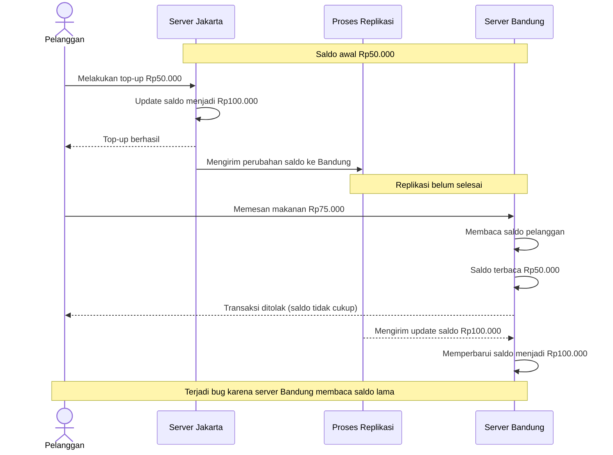
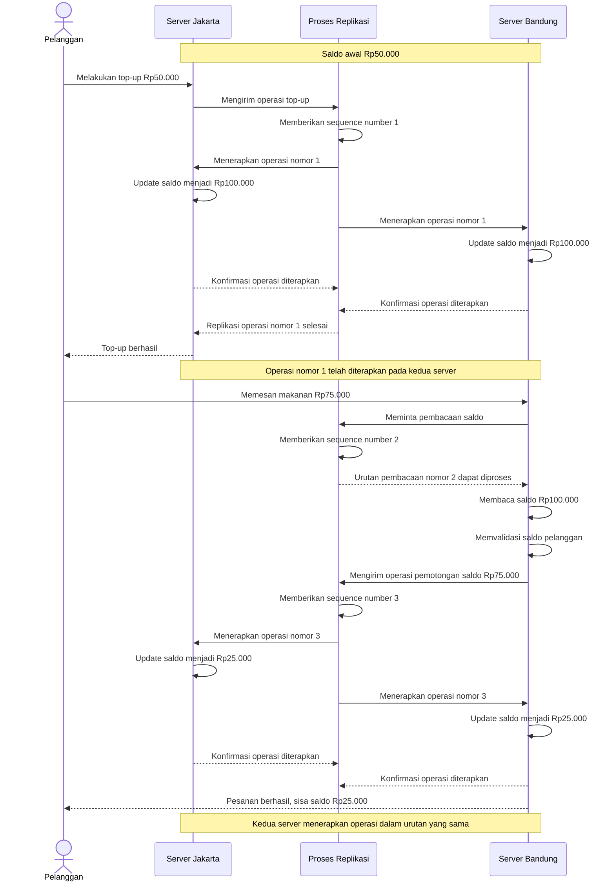
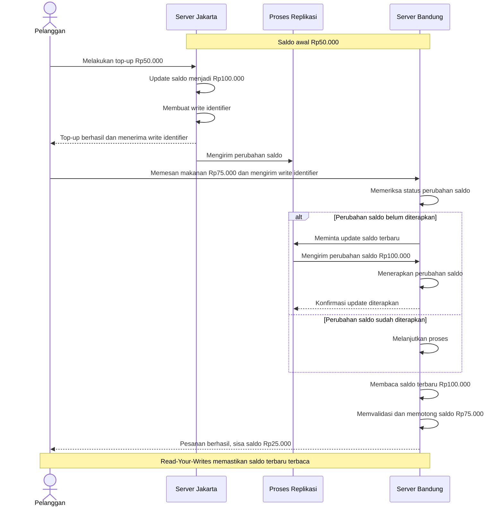

# Tugas 7 (Pekan 7) — Konsistensi Data

**Materi terkait:** Data-Centric Consistency (Sequential, Eventual), Client-Centric Consistency.

## Studi Kasus

Data saldo *e-wallet* pelanggan FoodGo berbeda antara server wilayah **Jakarta** dan **Bandung** karena replikasi antar server berjalan lambat. Contoh kasus nyata: pelanggan top-up saldo lewat server Jakarta, lalu dalam hitungan detik memesan makanan lewat aplikasi yang tersambung ke server Bandung — saldo belum ter-update, transaksi ditolak padahal saldo sebenarnya cukup.

## Tugas Kelompok

### Bagian 1 — Analisis (wajib)

### 1. Tentukan: apakah kasus ini **membutuhkan Sequential Consistency** (semua replika melihat urutan operasi yang sama) atau **cukup Eventual Consistency** (replika akan konsisten "pada akhirnya", boleh sementara berbeda)? Berikan argumen berbasis dampak bisnis (mis. kasus saldo *e-wallet* jauh lebih sensitif dibanding kasus "jumlah like" di media sosial).

### Hasil Analisis 1:
Menurut kelompok kami, penggunaan Eventual Consistency saja belum cukup untuk menangani data saldo e-wallet FoodGo. Kami memilih Sequential Consistency karena saldo pelanggan harus memiliki informasi yang konsisten di setiap server.

Pada kasus ini masalah yang terjadi adalah ketika pelanggan melakukan top-up melalui server Jakarta, tetapi beberapa detik kemudian saat melakukan pemesanan melalui server Bandung, saldo yang terbaca masih saldo lama. Hal ini terjadi karena perubahan saldo dari server Jakarta belum sampai ke server Bandung. Akibatnya, pelanggan bisa mengalami penolakan transaksi meskipun sebenarnya saldo mereka sudah mencukupi. Jika masalah seperti ini sering terjadi, pelanggan tentu bisa merasa dirugikan dan kehilangan kepercayaan terhadap layanan FoodGo.

Penggunaaan Sequential Consistency memastikan bahwa operasi dari seluruh proses terlihat seolah-olah dijalankan dalam satu urutan yang sama. Jadi, setiap server harus melihat urutan perubahan data yang konsisten. Berbeda dengan Sequential Consistency, Eventual Consistency masih memperbolehkan adanya perbedaan data antar-replika untuk sementara waktu. Data tersebut memang akan disamakan setelah proses sinkronisasi selesai, tetapi selama proses tersebut belum selesai, kemungkinan server membaca data lama masih bisa terjadi. Model ini lebih cocok untuk data yang tidak terlalu berpengaruh jika terlambat diperbarui, seperti jumlah like pada media sosial.

Kesimpulan: Menurut kelompok kami, Sequential Consistency lebih sesuai untuk pengelolaan saldo e-wallet FoodGo dibandingkan hanya menggunakan Eventual Consistency. Hal ini karena kesalahan informasi saldo bisa langsung memengaruhi transaksi pelanggan.

### 2. Jika kalian menyimpulkan Eventual Consistency saja **tidak cukup** untuk skenario ini, usulkan pendekatan **Client-Centric Consistency** yang relevan (mis. *Read-Your-Writes*: pelanggan yang baru top-up harus selalu melihat saldo terbarunya sendiri, walau replika lain belum sinkron).

### Hasil Analisis 2:

Selain Sequential Consistency, FoodGo juga dapat menerapkan Client-Centric Consistency, khususnya Read-Your-Writes Consistency. Read-Your-Writes Consistency merupakan jaminan bahwa perubahan data yang dilakukan oleh seorang pengguna dapat dilihat kembali ketika pengguna tersebut melakukan pembacaan data berikutnya.

Pada studi kasus FoodGo, penerapannya dapat dilakukan dengan cara:
1. Pelanggan melakukan top-up saldo melalui server Jakarta.
2. Server Jakarta mencatat perubahan saldo dan memberikan identitas unik pada transaksi top-up tersebut.
3. Ketika pelanggan berpindah ke server Bandung untuk melakukan pemesanan, aplikasi membawa informasi mengenai perubahan saldo yang sebelumnya dilakukan.
4. Server Bandung memeriksa apakah perubahan saldo tersebut sudah diterima. Jika belum, server mengambil pembaruan terlebih dahulu sebelum menampilkan saldo pelanggan.
5. Setelah saldo terbaru berhasil diperoleh, pelanggan dapat melanjutkan proses pemesanan.
Dengan cara ini, pelanggan tidak perlu khawatir melihat saldo lama hanya karena berpindah server setelah melakukan top-up.

Namun, karena sistem ini berkaitan dengan uang, FoodGo tetap perlu memastikan bahwa proses pemotongan saldo berjalan dengan aman. Misalnya, sistem harus mencegah pemotongan saldo dua kali atau transaksi yang membuat saldo menjadi tidak sesuai. Hal ini karena Read-Your-Writes hanya menjamin perubahan pengguna terlihat pada pembacaan berikutnya, bukan menjamin seluruh proses transaksi keuangan berjalan aman secara otomatis.

### 3. Gambarkan **diagram alir urutan (sequence diagram)** yang menunjukkan operasi read/write antara pelanggan, server Jakarta, server Bandung, dan proses replikasi — untuk skenario **tanpa** jaminan konsistensi (bug terjadi) DAN skenario **dengan** solusi yang kalian usulkan (bug teratasi). Pakai Mermaid (`sequenceDiagram`) di `README.md` — lihat contoh cara pakai di Tugas 2.

### Hasil Analisis 3:
### 1. Diagram tanpa jaminan konsistensi (bug terjadi)
   Pada skenario ini, proses replikasi antara server Jakarta dan Bandung mengalami keterlambatan. Akibatnya, server Bandung masih membaca saldo lama meskipun pelanggan sudah berhasil melakukan top-up melalui server Jakarta.


Penjelasan diagram :

Pada kondisi ini, pelanggan memiliki saldo awal sebesar Rp50.000. Kemudian pelanggan melakukan top-up sebesar Rp50.000 melalui server Jakarta. Setelah proses top-up berhasil, saldo pelanggan di server Jakarta berubah menjadi Rp100.000.

Namun, perubahan saldo tersebut belum langsung diterima oleh server Bandung karena proses replikasi masih berlangsung. Ketika pelanggan berpindah ke server Bandung dan memesan makanan seharga Rp75.000, server Bandung masih membaca saldo lama sebesar Rp50.000.

Akibatnya, sistem menolak transaksi karena menganggap saldo pelanggan tidak mencukupi. Padahal, saldo sebenarnya sudah mencapai Rp100.000. Setelah itu, proses replikasi baru selesai dan server Bandung menerima pembaruan saldo.

Dari kejadian tersebut dapat dilihat bahwa keterlambatan replikasi menyebabkan perbedaan data antara kedua server dan membuat transaksi pelanggan gagal.

### 2. Diagram dengan solusi (bug teratasi)


### a. Penerapan Solusi Sequential Consistency
Pada skenario ini, FoodGo menerapkan Sequential Consistency sesuai dengan pendekatan yang diusulkan pada hasil analisis 1. Pendekatan ini memastikan seluruh server melihat dan menerapkan urutan operasi yang sama. Setiap perubahan data diberikan nomor urut (sequence number) oleh proses replikasi agar operasi dapat diterapkan secara berurutan pada server Jakarta maupun Bandung. Dengan demikian, ketika pelanggan melakukan top-up melalui server Jakarta dan kemudian melakukan pemesanan melalui server Bandung, perubahan saldo sebelumnya harus sudah diterapkan sebelum operasi berikutnya diproses.




Penjelasan diagram:

Pada skenario ini, pelanggan memiliki saldo awal sebesar Rp50.000. Kemudian pelanggan melakukan top-up sebesar Rp50.000 melalui server Jakarta. Server Jakarta mengirimkan operasi top-up ke proses replikasi untuk diberikan nomor urut (sequence number) 1.

Setelah mendapatkan nomor urut, perubahan saldo diterapkan pada server Jakarta dan Bandung. Kedua server kemudian memberikan konfirmasi bahwa operasi tersebut telah diterapkan. Dengan demikian, saldo pada kedua server menjadi Rp100.000 sebelum pelanggan melanjutkan transaksi.

Selanjutnya, pelanggan berpindah ke server Bandung untuk memesan makanan seharga Rp75.000. Permintaan pembacaan saldo diberikan nomor urut 2 dan diproses setelah operasi top-up sebelumnya selesai diterapkan. Server Bandung kemudian membaca saldo sebesar Rp100.000 dan melakukan validasi saldo pelanggan.

Karena saldo mencukupi, server Bandung mengirimkan operasi pemotongan saldo sebesar Rp75.000 kepada proses replikasi. Operasi tersebut diberikan nomor urut 3 dan diterapkan pada kedua server. Setelah proses pembaruan selesai, saldo pelanggan menjadi Rp25.000 dan pesanan berhasil diproses.

Dengan penerapan Sequential Consistency, seluruh server melihat dan menerapkan urutan operasi yang sama, yaitu top-up, pembacaan saldo, kemudian pemotongan saldo. Hal ini mencegah terjadinya pembacaan saldo lama akibat perbedaan urutan penerapan operasi antarserver.


### b. Penerapan Solusi Client-Centric Consistency
Pada skenario ini, FoodGo menerapkan solusi Client-Centric Consistency, khususnya Read-Your-Writes Consistency, sesuai dengan pendekatan yang diusulkan pada hasil analisis 2. Pendekatan ini memastikan bahwa perubahan saldo yang sebelumnya dilakukan pelanggan sudah diterapkan sebelum server Bandung membaca saldo untuk memproses transaksi.



Penjelasan diagram :

Pada skenario ini, pelanggan melakukan top-up sebesar Rp50.000 melalui server Jakarta sehingga saldo berubah dari Rp50.000 menjadi Rp100.000. Setelah perubahan tersebut dicatat, server Jakarta memberikan identitas perubahan (write identifier) sebagai penanda bahwa pelanggan telah melakukan pembaruan saldo.

Ketika pelanggan berpindah ke server Bandung untuk memesan makanan seharga Rp75.000, aplikasi turut mengirimkan informasi perubahan saldo sebelumnya.

Server Bandung kemudian memeriksa apakah perubahan saldo tersebut sudah diterapkan. Jika belum, server Bandung meminta pembaruan dari proses replikasi dan menunggu sampai saldo terbaru berhasil diterapkan.

Setelah pembaruan diterima, server Bandung membaca saldo sebesar Rp100.000. Karena saldo mencukupi untuk membayar pesanan sebesar Rp75.000, transaksi dapat diproses dan saldo pelanggan tersisa Rp25.000.

Dengan cara ini, pelanggan tidak lagi mengalami penolakan transaksi hanya karena server Bandung masih membaca saldo lama.

### 3. Perbandingan kedua diagram 

| Aspek | Tanpa Solusi | Sequential Consistency | Client-Centric (Read-Your-Writes) |
|---|---|---|---|
| Saldo awal | Rp50.000 | Rp50.000 | Rp50.000 |
| Top-up | Rp50.000 | Rp50.000 | Rp50.000 |
| Saldo setelah top-up di Jakarta | Rp100.000 | Rp100.000 | Rp100.000 |
| Kondisi replikasi | Terlambat | Operasi diterapkan sesuai urutan yang sama | Perubahan pelanggan dipastikan sudah diterapkan sebelum dibaca |
| Mekanisme | Replikasi tanpa jaminan konsistensi | Menggunakan sequence number | Menggunakan write identifier |
| Saldo yang dibaca Bandung | Rp50.000 | Rp100.000 | Rp100.000 |
| Pesanan makanan | Rp75.000 | Rp75.000 | Rp75.000 |
| Hasil transaksi | Ditolak | Berhasil | Berhasil |
| Sisa saldo | Tidak berubah (Rp50.000) | Rp25.000 | Rp25.000 |

Penjelasan Perbandingan:

Berdasarkan ketiga diagram tersebut, terlihat perbedaan proses pengelolaan saldo antara kondisi tanpa jaminan konsistensi, Sequential Consistency, dan Client-Centric Consistency. Pada kondisi tanpa solusi, keterlambatan replikasi menyebabkan server Bandung masih membaca saldo lama sebesar Rp50.000 sehingga transaksi ditolak.

Sementara itu, pada Sequential Consistency, seluruh server menerapkan operasi berdasarkan urutan yang sama sehingga server Bandung dapat membaca saldo terbaru sebesar Rp100.000 sebelum memproses transaksi. Pada Client-Centric Consistency dengan pendekatan Read-Your-Writes, server Bandung memastikan perubahan saldo yang sebelumnya dilakukan pelanggan sudah diterapkan sebelum melakukan pembacaan.

Dengan demikian, kedua pendekatan solusi dapat mengatasi masalah pembacaan saldo lama pada skenario FoodGo, tetapi memiliki mekanisme dan cakupan jaminan konsistensi yang berbeda. Sequential Consistency berfokus pada kesamaan urutan operasi seluruh proses, sedangkan Read-Your-Writes berfokus pada kemampuan pelanggan untuk melihat kembali perubahan data yang telah dilakukannya sendiri.

### Bagian 2 — Simulasi (opsional, nilai tambah)

Skeleton `src/replica_simulation.py` mensimulasikan dua replika (Jakarta & Bandung) dengan delay replikasi buatan. Lengkapi TODO untuk:
1. Menunjukkan kondisi **inconsistent read** (replika Bandung masih menunjukkan saldo lama walau Jakarta sudah update).
2. Mengimplementasikan mekanisme **Read-Your-Writes** sederhana (mis. dengan version/timestamp per client) yang memperbaiki masalah tersebut.

```bash
python3 src/replica_simulation.py
```

### Kesimpulan
Berdasarkan hasil analisis, dapat disimpulkan bahwa pengelolaan data saldo e-wallet FoodGo membutuhkan penerapan Sequential Consistency karena berkaitan langsung dengan transaksi keuangan pelanggan. Penggunaan Eventual Consistency saja belum cukup karena masih memungkinkan terjadinya perbedaan saldo antarserver selama proses replikasi berlangsung. Kondisi tersebut dapat menyebabkan transaksi pelanggan ditolak meskipun saldo sebenarnya mencukupi.

Untuk mengatasi masalah tersebut, FoodGo dapat menerapkan Client-Centric Consistency, khususnya Read-Your-Writes Consistency. Pendekatan ini memastikan bahwa perubahan saldo yang dilakukan pelanggan, seperti top-up, tetap dapat terbaca ketika pelanggan berpindah server. Dengan demikian, server Bandung harus memastikan pembaruan saldo dari server Jakarta sudah diterapkan sebelum memproses transaksi.

Berdasarkan perbandingan kedua diagram, penerapan solusi tersebut dapat mencegah server membaca saldo lama sehingga transaksi pelanggan dapat diproses sesuai kondisi saldo sebenarnya. Namun, FoodGo juga perlu memastikan keamanan transaksi melalui validasi saldo dan pencegahan pemotongan saldo ganda. Dengan penerapan konsistensi data yang tepat, FoodGo dapat menjaga keakuratan informasi saldo, mengurangi kegagalan transaksi, serta meningkatkan kepercayaan pelanggan terhadap layanan.
